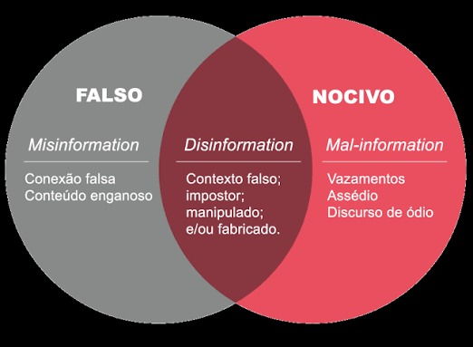
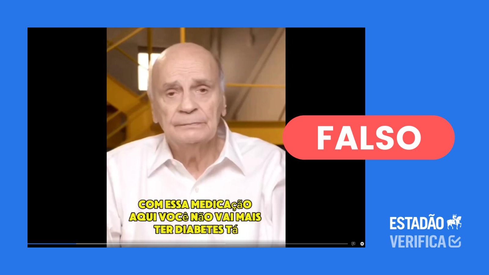
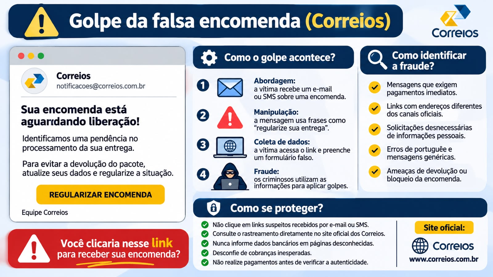

<!-- _class: hero -->

# Cyber
<h2> Educação contra a desinformação</h2>

  Cidadania Digital
  <i>Fake-News</i>
  Redes Sociais

 

 

Apresentação + Jogo Digital Interativo

---

<!-- _class: divider -->

01 — Contextualização

## Quem somos?

---

## Curso

- Discentes do curso de Tecnologia em Analise e Desenvolvimento de Sistemas do IFCE Campus Itapipoca.

 

## Projeto

- Bytes para Cidadania: Projeto que engloba 4 ações de extensão visando a **promoção da Cidadania Digital nas escolas**.

 

## Nossa ação

- Ação de extensão Cyber: Trabalha o assunto de **<i>Fake-news</i> e desinformação** nas escolas. 

---

<!-- _class: divider -->

01 — Contextualização

## O que é Cidadania Digital?

---

## O que é?

- Cidadania Digital pode ser entendido como a capacidade de um indivíduo de participar da sociedade por meio de recursos online, abrangendo tanto o acesso aos dispositivos e meios necessários quanto às habilidades sociocomportamentais requeridas (SILVEIRA, 2010).

 

### Para além do domínio dos recursos tecnológicos:

- A Cidadania Digital não depende apenas do acesso e do domínio tecnológico, mas também da compreensão dos mecanismos, algoritmos e formas de interação existentes no ciberespaço.

---

## Inteligência digital

 O Digital Inteliggence Framework (DK Framework) do Institute of Electrical and Electronics Engineers (IEEE), elenca 8 competências para Cidadania Digital: 

- Identidade do cidadão;
- Equilíbrio no uso da tecnologia;
- Gestão de riscos cibernéticos comportamentais;
- Gestão de segurança cibernética pessoal;
- Empatia digital;
- Gestão de pegada digital;
- Gestão de privacidade;
- **Letramento midiático e informacional: possuir meios de encontrar, organizar, avaliar e analisar as informações e conteúdos de mídias consumidos, exercendo postura crítica diante deles**.

---

## Conclusão

Cidadania Digital pode ser entendida como a capacidade de usar a tecnologia e as mídias digitais de forma **segura**, **responsável** e **ética**.

---

<!-- _class: divider -->

02 — Conteúdo

## <i>Fake-News</i>

---

---

## O fenômeno das <i>Fake News</i>

<table class="cols">
<tr>
<td width="40%">

- Informações falsas apresentadas como verdadeiras.
- Conteúdos que imitam notícias e fontes confiáveis.
- Disseminação acelerada pelas redes sociais.
- Compartilhamentos sem verificação dos fatos.

 

</td>
<td width="60%">

</td>
</tr>
</table>

---

## Desordem informacional

<table class="cols">
<tr>
<td width="50%">

- Excesso de informações circulando no ambiente digital.
- Conteúdos falsos, manipulados ou descontextualizados.
- Diferentes níveis de intenção e propósito.
- Classificação proposta por Wardle e Derakhshan (2017).

 

</td>
<td width="50%">

</td>
</tr>
</table>

---

## IA Generativa e Fake News

<table class="cols">
<tr>
<td width="45%">

- Uso de IA para manipular rostos e vozes (Deepfake).
- Simulação de recomendações de pessoas famosas.
- Produtos milagrosos e promessas de cura.
- Uso indevido da imagem de profissionais para gerar confiança.
- Golpes financeiros e riscos à saúde.

 

</td>
<td width="55%">

    

  Captura utilizada pelo Estadão Verifica em uma checagem de outro vídeo falso envolvendo Drauzio Varella. A imagem mostra a alegação falsa de cura do diabetes.

</td>
</tr>
</table>

---

## Combate às Fake News e cidadania digital

<table class="cols">
<tr>
<td width="50%">

- Verificar a fonte e a autoria da informação.
- Comparar a notícia com outros veículos confiáveis.
- Conferir datas, imagens e contexto.
- Desconfiar de promessas exageradas e conteúdos sensacionalistas.
- Evitar compartilhar informações sem confirmação.
- Desenvolver pensamento crítico e responsabilidade digital.

 

</td>
<td width="50%">

</td>
</tr>
</table>

---

## Pergunta:

Se uma informação parece verdadeira, tem milhares de curtidas e foi compartilhada por pessoas em quem confiamos, isso significa que podemos acreditar nela?

---

<!-- _class: divider -->

02 — Conteúdo

## Identificar informações falsas

---

## Como identificar e investigar?

<table class="cols">
<tr>
<td width="50%">

### Hierarquia de fontes
  - Priorizar fontes originais e oficiais.
  - Conferir a origem da informação.
  - Exemplos: editais, comunicados e portais oficiais.

 

</td>
<td width="50%">

### Leitura lateral
- Sair da publicação suspeita.
- Pesquisar em outras fontes.
- Comparar informações antes de acreditar.
- Sinais de alerta (Red Flags)
- Links suspeitos.
- Ausência de datas ou comprovações.
- Apelos como "compartilhe agora!".

</td>
</tr>
</table>

---

## Combate e prevenção

<table class="cols">
<tr>
<td width="50%">

### Debunking — Corrigir
- Desmentir informações falsas com evidências.
- Apresentar o fato correto.
- Explicar o erro e indicar fontes confiáveis.

 

</td>
<td width="50%">

### Prebunking — Prevenir
- Reconhecer estratégias de manipulação.
- Desenvolver pensamento crítico.
- Criar o hábito de verificar informações.

</td>
</tr>
</table>

<!-- _class: divider

02 — Conteúdo

## Porquê
## acreditamos em fake-news?

---

<table class="cols">
<tr>
<td width="50%">

## Psicologia Cognitiva e Social da Desinformação

- Emoções e tomada de decisões.
- Influência social no compartilhamento de informações.

 

</td>
<td width="50%">

## Sistema 1 e Sistema 2

- Daniel Kahneman — Dois sistemas de pensamento
- Sistema 1: rápido, automático e impulsivo.
- Sistema 2: lento, analítico e racional.
- Fake news exploram reações imediatas.
- Compartilhamento sem verificação.
- Exemplo: mensagem falsa sobre o bloqueio do WhatsApp.

</td>
</tr>
</table>

---

<table class="cols">
<tr>
<td width="50%">

## Sequestro Emocional

- Uso de emoções para influenciar decisões.
- Medo, ansiedade e urgência.
- Redução da capacidade de análise.
- Reações impulsivas diante de situações de pressão.
- Exemplo: falso pedido de dinheiro após suposto acidente.

</td>
<td width="50%">

## Psicologia Social do Boato

- Três processos de transformação dos boatos:
- Nivelamento: perda de detalhes.
- Acentuação: exagero de informações.
- Assimilação: adaptação às crenças pessoais.

</td>
</tr>
</table>

--- -->

<!-- _class: divider

02 — Conteúdo

## Saúde digital

---

<table class="cols">
<tr>
<td width="50%">

## Equilíbrio no uso da tecnologia

- Gerenciar o tempo de tela e o consumo de informações.
- Utilizar a tecnologia de maneira consciente e saudável.

 

</td>
<td width="50%">

## Doomscrolling

- Consumo compulsivo de notícias e conteúdos motivado pela ansiedade.
- Pode aumentar o estresse, prejudicar o sono e comprometer a atenção e a memória.

</td>
</tr>
</table>

## Autocuidado e colaboração

- Reconhecer os próprios limites no ambiente digital.
- Equilibrar participação online, descanso e responsabilidades compartilhadas.

--- -->

<!-- _class: divider

02 — Conteúdo

## Golpes Virtuais

---

<table class="cols">
<tr>
<td width="50%">

## O que são golpes virtuais?
- Fraudes no ambiente digital;
- Manipulação e engano;
- Roubo de dados e dinheiro.

 

</td>
<td width="50%">

## Relação entre Fake News e golpes virtuais
- Disseminação de informações falsas;
- Notícias e anúncios fraudulentos;
- Falsas promoções e oportunidades;
- Links maliciosos disfarçados de notícias.

</td>
</tr>
</table>

---

<table class="cols">
<tr>
<td width="50%">

## Principais tipos de golpes
- Phishing;
- Falsas ofertas e promoções;
- Golpes envolvendo Pix;
- Perfis e páginas falsas;
- Falsos comunicados institucionais.

 

</td>
<td width="50%">

## Estratégias utilizadas pelos criminosos
- Engenharia social;
- Manipulação emocional;
- Sensacionalismo e urgência;
- Uso da confiança e da desinformação.

</td>
</tr>
</table>

---

-->

---

<!-- _class: closing -->

# Cyber
## No combate à desinformação

  IFCE Campus Itapipoca
  Bytes para Cidadania

---

## Fontes

 

- <a href="./">Documento: "PROJETO DE CURRICULARIZAÇÃO DA EXTENSÃO
“Bytes para Cidadania”"</a>
- <a href="https://www.educamaisbrasil.com.br/educacao/dicas/o-que-sao-fake-news"> O QUE são fake news? Educa Mais Brasil, [S. l.], 2019. Dicas de Educação. Disponível em: https://www.educamaisbrasil.com.br/educacao/dicas/o-que-sao-fake-news. Acesso em: 16 set. 2026.</a>
- <a href="https://doi.org/10.1590/SciELOPreprints.3294"> FORSTER, Renê et al. Fake News: O que é, como se faz e por que funciona? SciELO Preprints, 7 dez. 2021. DOI: https://doi.org/10.1590/SciELOPreprints.3294. Acesso em: 19 set. 2026. </a>
- <a href="https://rm.coe.int/information-disorder-toward-an-interdisciplinary-framework-for-researc/1680762703"> WARDLE, Claire; DERAKHSHAN, Hossein. Information Disorder: Toward an interdisciplinary framework for research and policymaking. Strasbourg: Council of Europe, 2017. Disponível em: https://rm.coe.int/information-disorder-toward-an-interdisciplinary-framework-for-researc/1680762703. Acesso em: 20 set. 2026. </a>

--- 

## Fontes

 

- <a href="https://www.estadao.com.br/estadao-verifica/drauzio-varella-remedio-diabetes-ia/"> MARSCHALL, Luciana. É falso que Drauzio Varella tenha indicado remédio que promete curar diabetes. Disponível em: <https://www.estadao.com.br/estadao-verifica/drauzio-varella-remedio-diabetes-ia/>. Acesso em: 3 nov.. 2026. </a>
- <a href="https://cartilha.cert.br/">CERT.br. Cartilha de Segurança para Internet.</a>
- <a href="#">BRASIL. Ministério da Justiça e Segurança Pública. Prevenção contra golpes na internet.</a>
- <a href="#">POLÍCIA FEDERAL. Cartilhas de Segurança da Informação.</a>
- <a href="#">GABINETE DE SEGURANÇA INSTITUCIONAL. Materiais Educativos em Cibersegurança.</a>
